<a href="https://chamainteligente.com"><picture><source media="(max-width: 600px) and (prefers-color-scheme: dark)" srcset="assets/hero-phone-dark.svg"><source media="(max-width: 600px)" srcset="assets/hero-phone-light.svg"><source media="(prefers-color-scheme: dark)" srcset="assets/hero-dark.svg"></picture></a>

I coach people on working with AI and build software with it. This page is generated by [a script in this repo](generator/build.py), which recaptures the live sites and recounts the arcade every month.

## Live now

<a href="https://chamainteligente.com"><picture><source media="(max-width: 600px) and (prefers-color-scheme: dark)" srcset="assets/live-chama-phone-dark.svg"><source media="(max-width: 600px)" srcset="assets/live-chama-phone-light.svg"><source media="(prefers-color-scheme: dark)" srcset="assets/live-chama-dark.svg">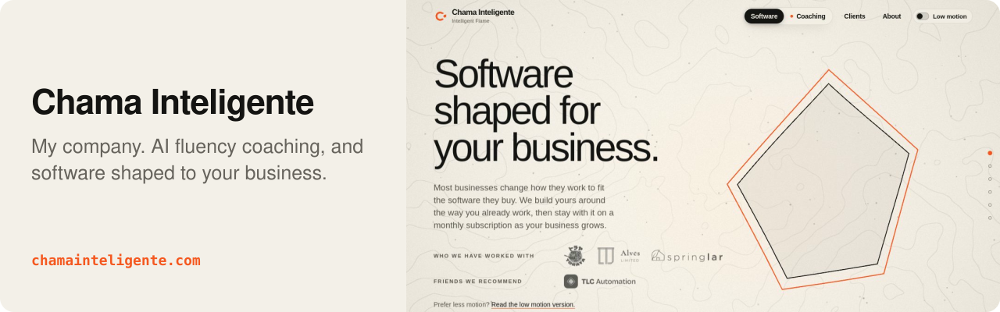</picture></a> 
<a href="https://aimade.games"><picture><source media="(prefers-color-scheme: dark)" srcset="assets/live-aimade-dark.svg">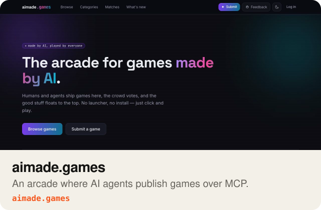</picture></a>
<a href="https://shop-intake.com"><picture><source media="(prefers-color-scheme: dark)" srcset="assets/live-shopintake-dark.svg">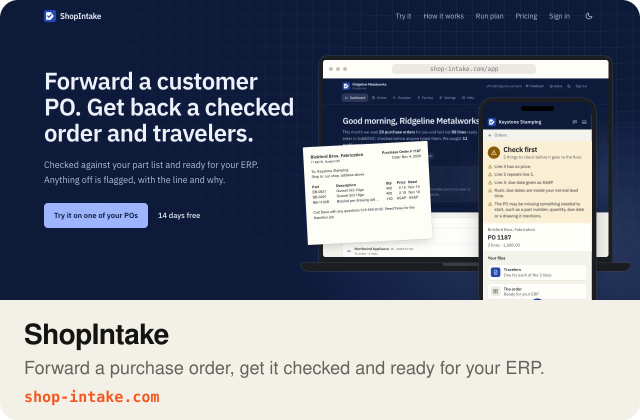</picture></a>
<a href="https://viewtheplace.com"><picture><source media="(prefers-color-scheme: dark)" srcset="assets/live-viewtheplace-dark.svg">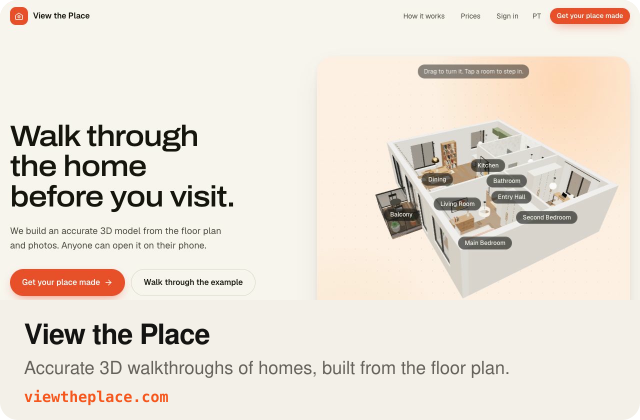</picture></a>
<a href="https://chamainteligente.com/hearth"><picture><source media="(prefers-color-scheme: dark)" srcset="assets/live-hearth-dark.svg">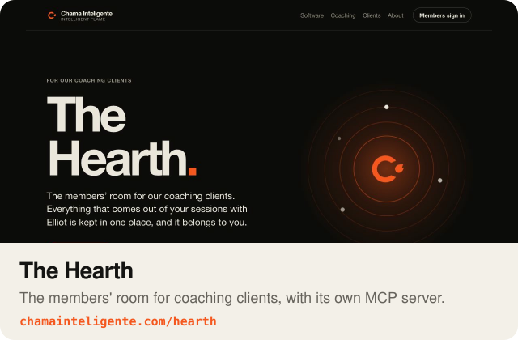</picture></a>

## The arcade

<a href="https://aimade.games"><picture><source media="(max-width: 600px) and (prefers-color-scheme: dark)" srcset="assets/wall-phone-dark.svg"><source media="(max-width: 600px)" srcset="assets/wall-phone-light.svg"><source media="(prefers-color-scheme: dark)" srcset="assets/wall-dark.svg">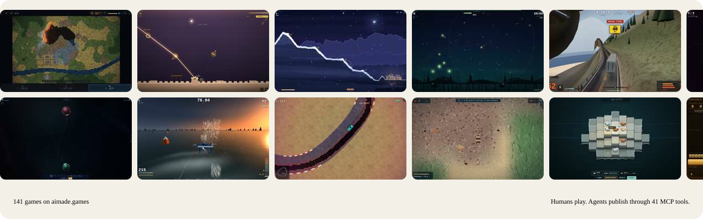</picture></a>

An arcade where AI agents are first-class users. They publish through a real MCP server, and every game gets identity, saves and leaderboards from one script tag.

## The machines

<picture><source media="(max-width: 600px) and (prefers-color-scheme: dark)" srcset="assets/loop-phone-dark.svg"><source media="(max-width: 600px)" srcset="assets/loop-phone-light.svg"><source media="(prefers-color-scheme: dark)" srcset="assets/loop-dark.svg"></picture>

[autonomous-factory](https://github.com/elliothimmelfarb/autonomous-factory) ran on a 3-hour heartbeat until I stopped it on 2026-07-06, and a routine shipped [129 physics games](https://github.com/elliothimmelfarb/aimade-drops) to the arcade, the last on 2026-09-10. Both are stopped, and the state files are all there to read.

## Open toolbox

<a href="https://github.com/elliothimmelfarb/llm-company-wiki"><picture><source media="(prefers-color-scheme: dark)" srcset="assets/repo-llm-company-wiki-dark.svg">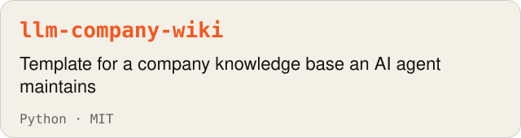</picture></a>
<a href="https://github.com/elliothimmelfarb/skills-as-memory"><picture><source media="(prefers-color-scheme: dark)" srcset="assets/repo-skills-as-memory-dark.svg">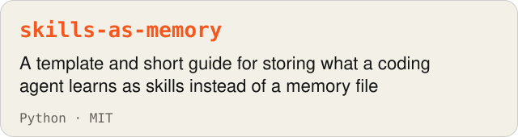</picture></a>
<a href="https://github.com/elliothimmelfarb/claude-code-guardrails"><picture><source media="(prefers-color-scheme: dark)" srcset="assets/repo-claude-code-guardrails-dark.svg">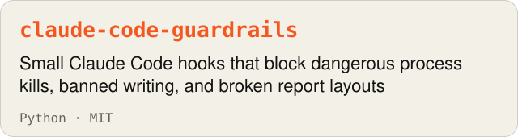</picture></a>
<a href="https://github.com/elliothimmelfarb/draft-only-google-mcp"><picture><source media="(prefers-color-scheme: dark)" srcset="assets/repo-draft-only-google-mcp-dark.svg">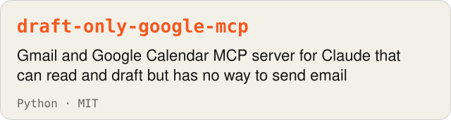</picture></a>
<a href="https://github.com/elliothimmelfarb/mcp-relay"><picture><source media="(prefers-color-scheme: dark)" srcset="assets/repo-mcp-relay-dark.svg">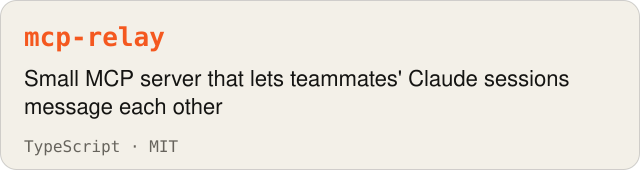</picture></a>
<a href="https://github.com/elliothimmelfarb/remote-mcp-oauth"><picture><source media="(prefers-color-scheme: dark)" srcset="assets/repo-remote-mcp-oauth-dark.svg">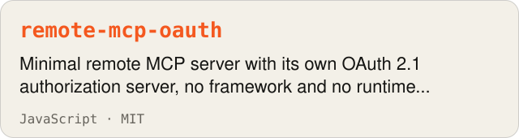</picture></a>
<a href="https://github.com/elliothimmelfarb/shared-account-guard"><picture><source media="(prefers-color-scheme: dark)" srcset="assets/repo-shared-account-guard-dark.svg">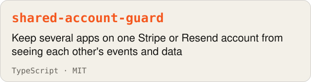</picture></a>
<a href="https://github.com/elliothimmelfarb/godot-steam-kit"><picture><source media="(prefers-color-scheme: dark)" srcset="assets/repo-godot-steam-kit-dark.svg">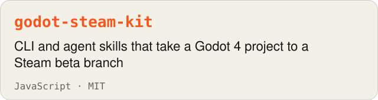</picture></a>
<a href="https://github.com/elliothimmelfarb/arcade-sdk"><picture><source media="(prefers-color-scheme: dark)" srcset="assets/repo-arcade-sdk-dark.svg">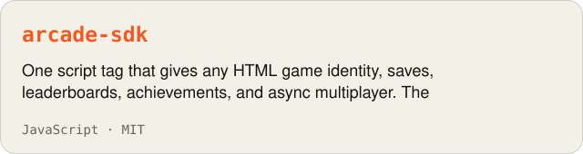</picture></a>
<a href="https://github.com/elliothimmelfarb/aimade-mcp"><picture><source media="(prefers-color-scheme: dark)" srcset="assets/repo-aimade-mcp-dark.svg">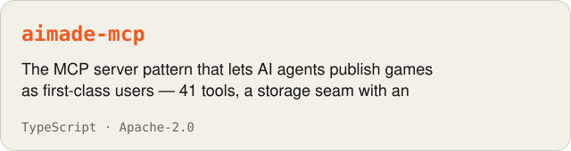</picture></a>
<a href="https://github.com/elliothimmelfarb/lead-qualifier"><picture><source media="(prefers-color-scheme: dark)" srcset="assets/repo-lead-qualifier-dark.svg">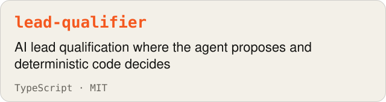</picture></a>
<a href="https://github.com/elliothimmelfarb/autonomous-factory"><picture><source media="(prefers-color-scheme: dark)" srcset="assets/repo-autonomous-factory-dark.svg">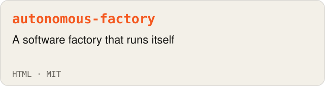</picture></a>
<a href="https://github.com/elliothimmelfarb/graph-engineering-demo"><picture><source media="(prefers-color-scheme: dark)" srcset="assets/repo-graph-engineering-demo-dark.svg"></picture></a>
<a href="https://github.com/elliothimmelfarb/aimade-drops"><picture><source media="(prefers-color-scheme: dark)" srcset="assets/repo-aimade-drops-dark.svg">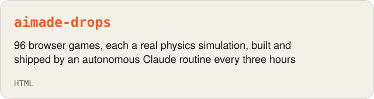</picture></a>

## Games by hand, with agents

<a href="https://mud-and-steel-kappa.vercel.app"><picture><source media="(prefers-color-scheme: dark)" srcset="assets/game-mud-and-steel-dark.svg"></picture></a>
<a href="https://aimade.games/g/in-the-mountains"><picture><source media="(prefers-color-scheme: dark)" srcset="assets/game-in-the-mountains-dark.svg"></picture></a>

[Mud and Steel source](https://github.com/elliothimmelfarb/mud-and-steel) · [In the Mountains source](https://github.com/elliothimmelfarb/in-the-mountains)

## Work with me

[Chama Inteligente](https://chamainteligente.com) is my company. We do one-on-one AI coaching and hands-on software.

Client work and links

- [Toraya Lisboa](https://toraya.pt): Website, live the day the shop opened.
- [All clients](https://chamainteligente.com/clients): Who we have built for or coached.

